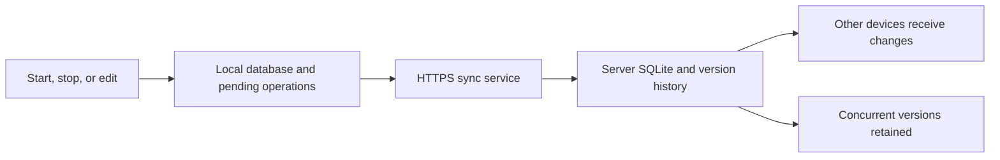

<div align="center">

<table align="center">
  <tr>
    <td>
<pre>
██       ██    ██  ██    ██   ██████   ██    ██  ██████
██        ██  ██   ██    ██  ██        ██    ██    ██
██         ████    ██    ██   ██████   ████████    ██
██          ██     ██    ██        ██  ██    ██    ██
███████     ██      ██████    ██████   ██    ██  ██████
</pre>
    </td>
  </tr>
</table>

<p><a href="README.md">简体中文</a> | <strong>English</strong></p>

</div>

# Lyushi · 柳时

## Download

**[Download 0.4.0 beta](https://github.com/Chanisyu/Lyushi/releases/tag/v0.4.0)** · [All releases](https://github.com/Chanisyu/Lyushi/releases) · [0.3.0 preview](https://github.com/Chanisyu/Lyushi/releases/tag/v0.3.0)

| Platform | Prebuilt package |
| --- | --- |
| Windows 11 x64 | [ZIP](https://github.com/Chanisyu/Lyushi/releases/download/v0.4.0/lyushi-windows-0.4.0-beta.zip); extract everything and run `Lyushi-0.4.0/lyushi.exe` |
| Android | [APK](https://github.com/Chanisyu/Lyushi/releases/download/v0.4.0/lyushi-android-0.4.0-beta.apk); currently debug-signed |
| Ubuntu 26.04 LTS amd64 | [DEB](https://github.com/Chanisyu/Lyushi/releases/download/v0.4.0/lyushi_0.4.0_amd64.deb) |
| Self-hosted server | [Linux amd64 server bundle](https://github.com/Chanisyu/Lyushi/releases/download/v0.4.0/lyushi-server-0.4.0-linux-amd64.zip), including deployment configuration and licenses |

Choose these files under **Assets** on the release page. GitHub's automatic **Source code** downloads contain source files, not installers. Synchronization requires a self-hosted server and device keys. Version 0.3.0 uses an older synchronization protocol; upgrade to 0.4.0 to connect to the current server.


Lyushi is a personal time tracker that organizes entries into separate ledgers. It supports Android, Windows, and Ubuntu, stores data locally first, works offline, and can synchronize devices through a self-hosted server.

Daily tracking consists of four steps: select a ledger, enter an activity, start tracking, and stop tracking. An active entry does not require the application to remain running. Closing and reopening the application restores the unfinished entry.

The project's own source code and documentation are licensed under the [Apache License 2.0](LICENSE). Third-party components retain their respective licenses; see [Third-party notices](THIRD_PARTY_NOTICES.md), currently maintained in Chinese.

[Changelog (Chinese)](CHANGELOG.md)

## Contents

- [Features and scope](#features-and-scope)
- [Installation](#installation)
- [Initial configuration](#initial-configuration)
- [Usage](#usage)
- [Synchronization and data handling](#synchronization-and-data-handling)
- [Upgrading to 0.4.0](#upgrading-to-040)
- [Server deployment](#server-deployment)
- [Backups, recovery, and device management](#backups-recovery-and-device-management)
- [Project structure and module responsibilities](#project-structure-and-module-responsibilities)
- [Building from source](#building-from-source)
- [Running tests](#running-tests)
- [Troubleshooting](#troubleshooting)
- [License and contributions](#license-and-contributions)

## Features and scope

| Feature | Description |
| --- | --- |
| Separate ledgers | Create, select, rename, and delete ledgers; view each ledger's entries separately |
| Task tags | One optional tag per entry, with selection, creation, deletion, and device synchronization |
| Start and stop | Save actual start and end times and display elapsed seconds; no pause function |
| Session recovery | Closing the application leaves the entry unfinished; reopening restores it |
| Entry management | View activities, timestamps, and durations; add past entries, edit, or delete individual entries |
| JSON backups | Export all ledgers; merge imports, deduplicate matching content, and preserve differing versions |
| CSV export | Export the current ledger or all ledgers for spreadsheet use |
| Device synchronization | Synchronize entries and deletions through a self-hosted Go + SQLite service |
| Offline operation | Save locally and synchronize after reconnection; preserve concurrent versions |
| Appearance | Simplified Chinese interface with light, dark, and system theme options |

All dates and times are displayed in Beijing Time (UTC+8). The application reads the device clock and does not provide an independent network time service. An incorrect device clock can affect recorded timestamps.

The project is intended for personal use. All device keys access the same collection of ledgers; they do not provide separate user accounts or per-ledger access controls. The server can read entry contents. End-to-end encryption, team management, billing, task management, and statistical reports are not currently provided.

The English README documents the existing application; the application interface itself currently remains in Simplified Chinese. Relevant Chinese button labels are included below.

## Installation

The current version is **0.4.0**, available as a pre-release. Installation packages and release notes are linked above.

| Platform | Verified environment | Installation file |
| --- | --- | --- |
| Windows | Windows 11, x64 | `lyushi-windows-0.4.0-beta.zip` |
| Android | Android 17 | `lyushi-android-0.4.0-beta.apk` |
| Ubuntu | Ubuntu 26.04 LTS, amd64 | `lyushi_0.4.0_amd64.deb` |
| Sync server | Ubuntu 24.04, x64 | `lyushi-server-linux-amd64` |

Locally built artifacts are stored in `dist/`, which is excluded from source control. Android's configured minimum version is Android 8.0 (API 26); this does not mean every older device or OS version has been tested.

### Windows

1. Extract the complete ZIP archive to a writable directory.
2. Run `Lyushi-0.4.0/lyushi.exe`.
3. Keep the bundled DLLs, plugins, and license files alongside the executable. Do not copy only the EXE.

Application data is stored in the current OS user's application data directory, separately from the installation files. Export a JSON backup before upgrading, and do not overwrite the user data directory when replacing the program.

### Android

Transfer the APK to the phone, open it in a file manager, and follow the system prompts to allow installation from that source.

The current APK is signed with a debug certificate and is intended for evaluation rather than app-store distribution. Public releases should use a dedicated, securely retained release signing key. Packages signed with different certificates generally cannot replace one another directly; export a backup before migrating.

### Ubuntu 26.04 LTS

Run the following command in the directory containing the package:

```bash
sudo apt install ./lyushi_0.4.0_amd64.deb
```

Launch “柳时” from the application menu or run `lyushi`. Qt 6, the SQLite driver, and a working desktop keyring are required. Runtime dependencies are declared in the package.

## Initial configuration

### Standalone use

Create a ledger after the first launch. No account, device key, or server is required. Fresh installations built from the current source do not include a private server address.

### Enable device synchronization

1. Deploy the self-hosted service as described below and create a separate key for each device.
2. In Settings (`设置`), enter the same HTTPS base URL on each client, for example `https://time.example.com/lyushi-api`.
3. Enter that device's key (`设备密钥`) and save. A key is a 64-character lowercase hexadecimal string; the device ID is not the key.
4. Return to the main screen, select Sync (`同步`), and confirm that the status reads Synced (`已同步`).
5. Repeat on the other devices using their respective keys.

Do not append `/v1/sync` to the server address; the client adds it automatically. Theme preferences remain local to each device. Finish active entries before changing connection settings.

Keys are protected using Windows DPAPI, Android Keystore, and Ubuntu Secret Service respectively. They are not included in JSON or CSV exports. On Ubuntu, ensure that `libsecret-tools` is installed and the desktop keyring is running and unlocked.

## Usage

### Track time

1. Select or create a ledger.
2. Enter the current activity.
3. Select Start tracking (`开始记录`). The application immediately saves the start time and displays elapsed time.
4. Select Stop tracking (`结束记录`) when finished. The application saves the end time and resulting duration.

While tracking, ledger switching, ledger details, import/export, and connection configuration are unavailable. Closing the window, exiting the application, or restarting the device does not automatically finish the entry. Once synchronized, the same entry can be stopped from another device.

### Select and manage task tags

The Tag selector (`标签`) appears below the activity input. Choose No tag (`无标签`) or an existing tag before starting. Tags are shared across the personal workspace; entries remain assigned to their own ledgers.

- **Create**: select Add tag (`新增标签`, or `新增` on Android) to the right of the selector. Enter a name of up to 200 UTF-16 code units. The saved tag is immediately available and selected for use in later entries.
- **Delete**: select a tag and use Delete tag (`删除标签`, or `删除` on Android) to its right. After confirmation, removal synchronizes to other devices. Historical entries retain their original tag text.
- **Edit an entry**: when no timer is active, open an entry's Edit dialog to change or clear its tag. Past entries can also be created with tags.

Leading and trailing whitespace is trimmed. Deterministic identities deduplicate matching names. Re-adding a deleted name explicitly restores the option. Tag controls are locked while tracking. If deletion and offline creation conflict, deletion takes priority in the selector while conflicting content remains archived.

### View, add, and edit entries

When no entry is active, open Ledger details and management (`账本明细与管理`):

- **Add past entry (`补记`)**: enter an activity, start time, and end time to create a completed entry.
- **Edit (`修改`)**: select an entry and change its activity or timestamps. The end time cannot precede the start time.
- **Delete entry (`删除记录`)**: select an entry and confirm deletion. The deletion then synchronizes to other devices.
- **Rename (`改名`)**: change the current ledger's name.
- **Delete ledger (`删除账本`)**: type the exact ledger name to confirm deletion of the ledger and its entries.

Ledgers are identified by stable IDs. Matching names do not make two ledgers identical. Separation refers to entry ownership and display scope, not separate servers or authentication permissions.

### Export and import

| Action | Purpose and scope |
| --- | --- |
| Back up all JSON (`备份全部 JSON`) | Save all ledgers, entries, and retained versions for recovery or migration |
| Export current ledger CSV (`导出本账本 CSV`) | Export the selected ledger's entries as a spreadsheet-compatible file |
| Export all CSV (`导出全部 CSV`) | Export entries from all ledgers |
| Import JSON (`导入 JSON`) | Merge backup data, deduplicate matching content, and retain differing content as conflict versions |

CSV contains ledger names, activities, start and end times, durations in seconds, entry IDs, and tags. It is not a complete recovery format. CSV uses UTF-8 and handles spreadsheet formula prefixes. JSON imports are limited to 32 MiB per file; invalid formats, unknown fields, or invalid timestamps roll back the entire import.

Import is a merge, not a destructive reset-and-restore operation. Older backups do not directly override known deletions, and historical unfinished versions do not automatically become active timers. Before migrating, export JSON from the original device, import and verify it on the new device, and then configure synchronization.

## Synchronization and data handling

Each start, stop, edit, or deletion is saved locally together with a pending synchronization operation. Tracking remains available offline. After reconnection, retries reuse the same operation IDs to prevent duplicates.

Clients normally check for updates approximately every five seconds while running in the foreground. The retry interval increases after failures. Immediate background synchronization is not guaranteed on Android; opening the application resumes processing. A Synced status confirms completion of that synchronization cycle, not the existence of an independent remote backup.

When offline devices start or edit entries concurrently, the server retains concurrent versions rather than selecting a winner by device clock. View conflicts (`查看冲突`) displays retained content. If several unfinished versions exist, review and finish them individually before opening details. Viewing a conflict archive does not restart a historical timer.

Deletions propagate to other devices, but the current implementation uses logical deletion and retained version history. It does not promise immediate physical erasure from history, backups, or underlying storage. An unknown offline version is not deleted in advance by another device.

Clients retain the server identity and synchronization cursor. Reinitializing a server or changing to a different server can trigger identity protection; changing the URL alone is not a migration procedure. See the [synchronization protocol](docs/sync-protocol.md), currently maintained in Chinese.

## Upgrading to 0.4.0

Version 0.4.0 adds tag entities and per-entry tag snapshots, raising the synchronization capability version to 2. Clients send `X-Lyushi-Protocol: 2`. Before starting a write transaction, the server rejects older clients without this capability using HTTP 426.

Export JSON and back up the server database before upgrading, then update the server and all three clients. Existing databases, device keys, server identity, and pending operations are retained; no reset or new device registration is required. Older clients keep their local entries and can resume uploading after upgrading.

New JSON backups use `formatVersion: 2`, including available tags and deletion states. New clients still accept version 1 backups; older clients should not import version 2. 

## Server deployment

The following procedure targets Linux hosts with systemd and uses Ubuntu examples. The server listens only on `127.0.0.1:8093`; Caddy provides public HTTPS access. Docker is not required.

### 1. Prepare the server executable

Use a Linux amd64 release artifact or build from source, starting at the project root:

```bash
mkdir -p build
cd server
go test ./...
CGO_ENABLED=0 go build -trimpath -o ../build/lyushi-server .
```

The source requires Go 1.26 or later. The resulting executable runs independently; the deployment host does not need the Go compiler.

### 2. Install the executable and systemd service

Run these commands from the project root. If a `lyushi` service or data directory already exists, follow the upgrade procedure instead of reinitializing it:

```bash
sudo useradd --system --home-dir /var/lib/lyushi --shell /usr/sbin/nologin lyushi
sudo install -d -m 0755 /opt/lyushi
sudo install -d -m 0700 -o lyushi -g lyushi /var/lib/lyushi
sudo install -m 0755 build/lyushi-server /opt/lyushi/lyushi-server
sudo install -m 0644 deploy/lyushi.service /etc/systemd/system/lyushi.service
sudo systemctl daemon-reload
sudo systemctl enable --now lyushi
curl --fail http://127.0.0.1:8093/health
```

When using a downloaded release artifact, replace `build/lyushi-server` with its actual path. `deploy/lyushi.service` configures a dedicated user, restricts writes to the service state directory, and sets memory limits.

### 3. Create device keys

Run this command separately for each device. The key output file must not already exist:

```bash
sudo -u lyushi /opt/lyushi/lyushi-server \
  --db /var/lib/lyushi/sync.sqlite \
  --create-device windows \
  --key-file /var/lib/lyushi/windows.key
```

Repeat with `android` and `ubuntu`, using distinct output filenames. Standard output contains the device ID; the file contains the device key. Retain the ID for future revocation.

Read the relevant file with administrative permissions in a trusted terminal and privately transfer the key to the target device's settings. After confirming that it has been saved, the plaintext handoff file may be removed; server authentication relies on the hash stored in the database. Do not commit keys, bundle them with releases, or paste them into public issue reports.

### 4. Configure HTTPS

Install Caddy, point the domain to the server, and ensure ports 80 and 443 are reachable. Replace the example domain and merge this block into your Caddy configuration. Do not overwrite an existing configuration wholesale:

```caddyfile
time.example.com {
    handle_path /lyushi-api/* {
        reverse_proxy 127.0.0.1:8093
    }
}
```

A standalone example is available at [deploy/Caddyfile.example](deploy/Caddyfile.example). `handle_path` strips `/lyushi-api`, so the service receives `/health` and `/v1/sync`.

```bash
sudo caddy validate --config /etc/caddy/Caddyfile --adapter caddyfile
sudo systemctl reload caddy
curl --fail https://time.example.com/lyushi-api/health
```

Configure clients with `https://time.example.com/lyushi-api`. The health endpoint requires no key and confirms reachability only; it does not replace client authentication and synchronization testing.

## Backups, recovery, and device management

### Server backups

The server provides a consistent SQLite backup command that can run while the service is active:

```bash
sudo install -d -m 0700 -o lyushi -g lyushi /var/lib/lyushi/backups
sudo -u lyushi /opt/lyushi/lyushi-server \
  --db /var/lib/lyushi/sync.sqlite \
  --backup /var/lib/lyushi/backups/sync-20261031.sqlite
```

Use a new filename for every backup. Backups include ledgers, version history, server identity, and device authentication hashes. Treat them as private data and retain an additional copy outside the server. The repository does not enable a scheduled backup policy; configure backup frequency, retention, and recovery exercises separately.

### Restore a server backup

1. Stop the `lyushi` service and any administrative processes that may access the database.
2. Move the current database and its `-wal` and `-shm` companion files together to a restricted incident-preservation directory. Do not combine old journal files with a restored database.
3. Copy the consistent backup to `/var/lib/lyushi/sync.sqlite`, set ownership to `lyushi:lyushi`, and set permissions to `0600`.
4. Start the service, check health, and verify synchronization on each client.

An older backup may lag behind a cursor already acknowledged by a client, causing identity or cursor protection to stop synchronization. Retain client JSON exports and the original server files, and review protocol state before planning recovery. The current version does not provide a one-click tool to reconcile these differences automatically.

### Revoke and rotate keys

```bash
sudo -u lyushi /opt/lyushi/lyushi-server \
  --db /var/lib/lyushi/sync.sqlite \
  --revoke-device DEVICE_ID
```

`DEVICE_ID` is the ID printed when the device was created. Revocation prevents further synchronization but leaves local entries intact. To rotate a key, create a new device key, update the client, confirm synchronization, and then revoke the old ID.

### Upgrade the service

Back up the database and current executable, stop the service, replace `/opt/lyushi/lyushi-server`, restart it, and verify health and client synchronization. Unconditional database downgrades are not guaranteed; check schema compatibility before reverting the executable.

## Project structure and module responsibilities

```text
Lyushi/
├── README.md             Default documentation in Simplified Chinese
├── README.en.md          English documentation
├── apps/
│   ├── android/          Native Android client
│   └── desktop/          Shared Qt client for Windows and Ubuntu
├── server/               Go + SQLite service and unit tests
├── deploy/               systemd service and reverse proxy example
├── scripts/              Build, packaging, and local integration scripts
├── docs/                 Protocol and maintenance documentation
├── LICENSE               Apache License 2.0
├── NOTICE                Project copyright notice
└── THIRD_PARTY_NOTICES.md Dependency and redistribution information
```

| Module | Responsibility |
| --- | --- |
| Tracking interface | Ledger selection, activity entry, start/stop, elapsed time, and operation restrictions |
| Local storage | Immediate persistence, transactional entry and outbox writes, and unfinished-entry recovery |
| Ledger management | Filter entries by ledger ID; add, edit, rename, and delete |
| Sync client | Authentication, uploads, paginated downloads, retries, and server identity checks |
| Sync server | Store operations and versions, deduplicate submissions, and propagate changes and concurrent branches |
| Conflict archive | Retain and display differing versions without silently overwriting them |
| Backup module | Complete JSON import/export, CSV export, and consistent server backups |
| System key storage | Protect the local device key separately from business-data backups |



Local `build/`, `dist/`, `.tools/`, `.secrets/`, and Android `local.properties` files are ignored and are not part of the public source distribution.

## Building from source

### Build requirements

| Component | Requirements or verified versions |
| --- | --- |
| Desktop | C++17, CMake 3.22+, Qt 6 Widgets / Sql / Network, and a compatible C++ compiler |
| Qt | 6.10.1 verified on Windows; 6.10.2 verified on Ubuntu |
| Android | JDK 17, Android SDK API 37, Gradle 9.6.0, Android Gradle Plugin 9.4.0 |
| Go service | Go 1.26+; Go 1.27.3 verified; dependencies pinned in `go.mod` and `go.sum` |

### Windows desktop

Install Qt 6, Ninja, CMake, and a compatible MinGW toolchain. Run in PowerShell, replacing the example paths with actual installation paths:

```powershell
./scripts/package-windows.ps1 -QtDirectory 'C:/Qt/6.10.1/mingw_64' -ToolchainDirectory 'C:/Qt/Tools/mingw1310_64'
```

The script uses MinGW's `objdump.exe` to inspect DLL dependencies recursively and `windeployqt.exe` to collect runtime libraries. Qt and the compiler must be compatible distributions. Paths can also be supplied through `LYUSHI_QT_DIR` and `LYUSHI_TOOLCHAIN_DIR`. This packaging script targets MinGW; MSVC builds require the matching Qt distribution and deployment tools.

### Ubuntu desktop

```bash
sudo apt update
sudo apt install build-essential cmake ninja-build qt6-base-dev \
  qt6-base-dev-tools libqt6sql6-sqlite qt6-qpa-plugins libsecret-tools
cmake -S apps/desktop -B build/desktop-linux -G Ninja -DCMAKE_BUILD_TYPE=Release
cmake --build build/desktop-linux --parallel 2
./build/desktop-linux/lyushi
```

To produce a DEB package, run `bash scripts/package-linux.sh` on Ubuntu. It builds and packages the application without installing or replacing system programs.

### Android

Install the JDK, Gradle, and Android SDK versions listed above, set `ANDROID_HOME`, and run from the project root:

```bash
gradle -p apps/android :app:assembleDebug --console=plain
```

The output is `apps/android/app/build/outputs/apk/debug/app-debug.apk`. A Gradle Wrapper is not currently included; install a matching Gradle version or configure it through Android Studio. Do not commit release signing keys or their configuration secrets.

### Cross-compile the server

Build a Linux amd64 executable on Linux:

```bash
mkdir -p build
cd server
CGO_ENABLED=0 GOOS=linux GOARCH=amd64 go build -trimpath -o ../build/lyushi-server-linux-amd64 .
```

Windows developers can set the same environment variables in PowerShell before running `go build`. `scripts/package-server.ps1 -GoExecutable <path-to-go.exe>` collects Go dependency licenses and packages an existing Linux server build. Generate `build/lyushi-server-linux-amd64` before running it.

## Running tests

The project includes server unit tests, desktop storage and recovery self-tests, local synchronization tests with two clients, and Android storage-protocol checks. Run tests with isolated databases and dedicated test devices.

Server unit tests:

```bash
cd server
go test ./...
```

Isolated desktop self-test on Linux:

```bash
QT_QPA_PLATFORM=offscreen ./build/desktop-linux/lyushi --self-test "$(mktemp -d)"
```

For local Windows integration testing, first build `build/desktop-windows/lyushi.exe` and `build/lyushi-server.exe`, then run:

```powershell
./scripts/test-sync-windows.ps1 -QtDirectory 'C:/Qt/6.10.1/mingw_64' -ToolchainDirectory 'C:/Qt/Tools/mingw1310_64'
```

The script uses a random loopback port, an isolated database, and a temporary test key. It does not access the production server. Android checks use the debug APK and can be run with `scripts/check-android.ps1 -Serial <adb-device-id> -AndroidSdk <sdk-path>` on an authorized test device.

## Troubleshooting

**Does tracking continue after closing the application?**

The unfinished state is retained. Elapsed time is calculated from the saved start timestamp; a background process does not need to run every second.

**Why are ledger switching and details unavailable?**

Finish active entries first. Concurrent offline activity can produce multiple unfinished versions that require individual review.

**The application reports an invalid or revoked device key (`设备密钥无效或已撤销`).**

Check the server address, confirm that the complete key was entered rather than the device ID, and verify that the device has not been revoked.

**The application reports that data is saved locally and awaiting reconnection (`本机已保存，等待重连`).**

Entries remain on the device. Check connectivity, DNS, HTTPS certificates, and server status, then synchronize again. Clients do not ignore certificate errors to establish a connection.

**Ubuntu cannot save the key.**

Check that `secret-tool` is available and the desktop Secret Service is running with an unlocked keyring. The application does not fall back to plaintext storage.

**Importing JSON creates retained versions (`保留的不同版本`).**

The backup and local data contain differing versions, so both are preserved. Viewing conflicts neither overwrites an entry nor starts a historical timer.

**Can data be recovered after uninstalling?**

Recovery requires a saved JSON backup or an available synchronization service. Android uninstallations may remove local application data. Synchronization does not replace an independent backup.

## License and contributions

The project's own code, scripts, and documentation are licensed under the Apache License 2.0, allowing use, modification, and redistribution subject to its terms. See [LICENSE](LICENSE) for the complete terms and [NOTICE](NOTICE) for copyright information. Third-party dependencies are not relicensed under Apache-2.0; in particular, applicable LGPL and other redistribution requirements for Qt remain in force.

Issue reports should include the application version, OS version, reproduction steps, expected behavior, and sanitized error messages. Do not attach device keys, private ledgers, server databases, or credential-bearing configurations. Contributions should describe their scope and verification results. Chinese source comments must use UTF-8 encoding.
