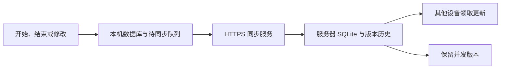

<div align="center">

<table align="center">
  <tr>
    <td>
<pre>
██       ██    ██  ██    ██   ██████   ██    ██  ██████
██        ██  ██   ██    ██  ██        ██    ██    ██
██         ████    ██    ██   ██████   ████████    ██
██          ██     ██    ██        ██  ██    ██    ██
███████     ██      ██████    ██████   ██    ██  ██████
</pre>
    </td>
  </tr>
</table>

<p><strong>简体中文</strong> | <a href="README.en.md">English</a></p>

</div>

# 柳时 · Lyushi

<font size="7"><b>
你是否体验过这样的感觉：
- 忙碌了一天，晚上坐下来却回想不起自己做了什么的挫败感。
- 感觉只玩了几分钟手机，但是一看钟却发现早已过去几小时？

这个项目可以让你像柳比歇夫一样，进行精确到秒的时间记录，确保清楚自己每一分每一秒都在干什么。
使用纸和笔记录就太原始了。这里提供三种客户端可供选择，以及免费的同步服务...只要你有一台自己的服务器。
</b></font>

---

柳时是一款以独立账本组织时间记录的个人工具，支持 Android、Windows 和 Ubuntu。应用采用本地优先的数据保存方式，可独立离线使用，也可通过自托管服务器同步三端数据。

日常记录仅需四个步骤：选择账本、填写事项、开始记录、结束记录。计时不依赖程序持续运行；关闭应用后，未结束的记录将在下次打开时恢复。

项目自身源码与文档采用 [Apache License 2.0](LICENSE)。第三方组件保留原有许可证，参见 [第三方依赖说明](THIRD_PARTY_NOTICES.md)。

## 目录

- [功能与范围](#功能与范围)
- [安装](#安装)
- [首次配置](#首次配置)
- [使用方法](#使用方法)
- [同步与数据处理规则](#同步与数据处理规则)
- [服务器部署](#服务器部署)
- [备份恢复与设备管理](#备份恢复与设备管理)
- [项目结构与模块职责](#项目结构与模块职责)
- [从源码构建](#从源码构建)
- [测试与验收](#测试与验收)
- [常见问题](#常见问题)
- [许可证与贡献](#许可证与贡献)

## 功能与范围

| 功能 | 说明 |
| --- | --- |
| 独立时间账本 | 新建、选择、改名和删除账本；各账本的记录分别展示 |
| 开始与结束 | 保存实际开始、结束时间，显示持续读秒；不提供暂停功能 |
| 记录恢复 | 关闭应用不会结束计时，重新打开后恢复未结束记录 |
| 明细管理 | 查看事项、起止时间与时长；支持补记、修改和单条删除 |
| JSON 备份 | 导出全部账本，导入时合并去重并保留不同版本 |
| CSV 导出 | 导出当前账本或全部账本，供表格软件查看 |
| 三端同步 | 通过自托管 Go + SQLite 服务同步记录与删除状态 |
| 离线记录 | 先保存本机，重连后同步；并发内容保留为可查看的版本 |
| 外观设置 | 简体中文；白天、黑夜、跟随系统三种主题 |

所有日期和时间固定按北京时间（UTC+8）显示。应用读取设备当前时间，未提供独立的网络校时服务；设备时间异常可能影响实际记录的起止时间。

本项目面向个人使用。不同设备密钥均访问同一套账本数据，不构成多用户账号或账本权限隔离。服务器可读取记录内容，当前不提供端到端加密、团队管理、计费、任务系统或统计报表。

## 安装

当前版本为 **0.3.1**。现有交付文件保留 `beta` 文件名，表示发布成熟度，三端服务器同步已由项目使用者人工验证成功。公开仓库和下载地址尚未创建，本文不预设仓库名称或发布链接。

| 平台 | 已验证环境 | 安装文件 |
| --- | --- | --- |
| Windows | Windows 11，x64 | `lyushi-windows-0.3.1-beta.zip` |
| Android | Android 17 | `lyushi-android-0.3.1-beta.apk` |
| Ubuntu | Ubuntu 26.04 LTS，amd64 | `lyushi_0.3.1_amd64.deb` |
| 同步服务器 | Ubuntu 24.04，x64 | `lyushi-server-linux-amd64` |

维护者本地构建产物位于 `dist/`，该目录不纳入源码版本。Android 配置的最低系统版本为 Android 8.0（API 26），不代表所有旧版本设备均已实际验收。

### Windows

1. 将 ZIP 文件完整解压至可写目录。
2. 运行 `Lyushi/lyushi.exe`。
3. 保留同目录的 DLL、插件和许可证文件，勿仅复制 EXE。

程序数据保存在当前系统用户的应用数据目录，与安装文件分离。替换程序前应导出 JSON 备份，更新时不得覆盖用户数据目录。

### Android

将 APK 传至手机，在文件管理器中打开，按系统提示允许相应来源安装。

现有 APK 使用调试签名，适合当前版本试用，不属于应用商店正式发行包。公开发行应建立独立且长期保存的发布签名；不同签名的安装包通常无法直接覆盖安装，迁移前应先导出备份。

### Ubuntu 26.04 LTS

在安装文件所在目录执行：

```bash
sudo apt install ./lyushi_0.3.1_amd64.deb
```

安装后从应用菜单打开“柳时”，或执行 `lyushi`。系统需要 Qt 6、SQLite 驱动和可用的桌面密钥环；安装包声明相关运行依赖。

## 首次配置

### 单机使用

首次启动后新建账本即可使用，无需账号、密钥或服务器。新安装的源码版本不内置私人服务器地址。

### 启用三端同步

1. 按下文部署自托管服务，并为每台设备分别创建密钥。
2. 在客户端“设置”中填写同一个 HTTPS 基础地址，例如 `https://time.example.com/lyushi-api`。
3. 填入该设备对应的设备密钥并保存。密钥为 64 位小写十六进制字符串；设备编号不是密钥。
4. 回到主页，点击“同步”，确认状态显示“已同步”。
5. 在其他设备重复上述配置，使用各自的设备密钥。

服务器地址不包含末尾的 `/v1/sync`；客户端会自行追加该路径。主题设置保存在各设备本机，不随账本同步。修改连接配置前应结束正在进行的记录。

设备密钥分别使用 Windows DPAPI、Android Keystore 和 Ubuntu Secret Service 保存。密钥不包含在 JSON 或 CSV 导出文件中。Ubuntu 上应确保 `libsecret-tools` 已安装，桌面密钥环已启动且解锁。

## 使用方法

### 记录时间

1. 选择或新建时间账本。
2. 输入正在进行的事项。
3. 点击“开始记录”。应用立即保存开始时刻，并显示经过时间。
4. 事项结束时点击“结束记录”。应用保存结束时刻与对应时长。

记录期间不能切换账本、查看账本明细、导入导出或修改连接配置。关闭窗口、退出应用或重启设备均不会自动结束记录。同步成功后，可在另一台设备接手结束同一条记录。

### 查看、补记和修改

在非记录状态打开“账本明细与管理”：

- **补记**：填写事项、开始时间和结束时间，创建已结束记录。
- **修改**：选择一条记录，修改事项或起止时间。结束时间不得早于开始时间。
- **删除记录**：选择记录并确认删除，删除状态随后同步至其他设备。
- **改名**：更改当前账本名称。
- **删除账本**：输入完整账本名称确认，删除该账本及其所属记录。

不同账本以稳定编号区分；名称相同不代表同一本账本。账本隔离指记录归属与显示范围独立，不表示不同账本使用不同服务器或认证权限。

### 导出和导入

| 操作 | 用途及范围 |
| --- | --- |
| 备份全部 JSON | 保存全部账本、记录及保留的版本，用于恢复或迁移 |
| 导出本账本 CSV | 将当前账本的记录导出为表格 |
| 导出全部 CSV | 将所有账本的记录导出为表格 |
| 导入 JSON | 合并备份中的数据，相同内容去重，不同内容保留为冲突版本 |

CSV 包含账本、事项、开始时间、结束时间、时长（秒）及记录编号，不作为完整恢复格式。CSV 使用 UTF-8 编码，并处理表格公式前缀。JSON 单文件导入上限为 32 MiB；格式错误、未知字段或非法时间会使整批导入回滚。

导入不等同于清空后还原：既有删除状态不会被旧备份直接覆盖，历史未结束版本也不会自动恢复成正在进行的计时。迁移前应在原设备导出 JSON，在新设备导入后核对记录，再配置同步。

## 同步与数据处理规则

每次开始、结束、修改或删除均先写入本机数据库，同时生成待同步变更。网络不可用时仍可记录，重连后自动重试，重试使用相同操作编号去重。

客户端在前台运行时通常每五秒检查更新，失败后逐步延长重试间隔。Android 后台状态不保证即时同步；重新打开应用后会继续处理。显示“已同步”仅表示该次同步完成，不表示存在独立的远程备份。

多台离线设备同时开始或修改时，服务器保留并发版本，不按设备时钟强行覆盖。界面中的“查看冲突”用于查看保留内容。若存在多个未结束版本，应逐条核对并结束，全部结束后再进入明细。冲突档案不会因查看而重新开始计时。

删除会同步传播，但当前采用逻辑删除及版本保留机制，不承诺立即从历史、备份和底层存储中物理抹除。未知的离线新版本也不会被另一端事先删除。

客户端会记录服务器身份及同步游标。重建服务器或直接更换为不同服务器可能触发身份保护，不能仅修改地址后假定自动完成迁移。完整协议见 [同步协议](docs/sync-protocol.md)。

## 服务器部署

下述步骤适用于具备 systemd 的 Linux 主机，示例以 Ubuntu 为准。服务器仅监听本机 `127.0.0.1:8093`，公网入口通过 Caddy 提供 HTTPS，无需 Docker。

### 1. 准备服务器程序

可使用 Linux amd64 发布文件，也可在源码的 `server/` 中构建：

```bash
mkdir -p build
cd server
go test ./...
CGO_ENABLED=0 go build -trimpath -o ../build/lyushi-server .
```

源码要求 Go 1.26 或更高版本。构建得到的二进制可独立运行，部署主机无需安装 Go 编译工具。

### 2. 安装程序和 systemd 服务

在项目根目录执行。若已有 `lyushi` 服务或数据目录，应按升级流程处理，不应重新初始化：

```bash
sudo useradd --system --home-dir /var/lib/lyushi --shell /usr/sbin/nologin lyushi
sudo install -d -m 0755 /opt/lyushi
sudo install -d -m 0700 -o lyushi -g lyushi /var/lib/lyushi
sudo install -m 0755 build/lyushi-server /opt/lyushi/lyushi-server
sudo install -m 0644 deploy/lyushi.service /etc/systemd/system/lyushi.service
sudo systemctl daemon-reload
sudo systemctl enable --now lyushi
curl --fail http://127.0.0.1:8093/health
```

如果使用下载的发布文件，将安装命令中的 `build/lyushi-server` 替换为其实际路径。`deploy/lyushi.service` 配置独立运行用户、仅允许状态目录写入及内存限制。

### 3. 创建设备密钥

为每台设备分别执行，密钥输出文件必须不存在：

```bash
sudo -u lyushi /opt/lyushi/lyushi-server \
  --db /var/lib/lyushi/sync.sqlite \
  --create-device windows \
  --key-file /var/lib/lyushi/windows.key
```

分别将 `windows` 改为 `android`、`ubuntu`，使用不同输出文件。命令标准输出为设备编号，文件内容才是设备密钥。妥善记录设备编号，以便撤销。

使用管理员权限在可信终端读取对应文件，私下交付至目标设备的设置页面。确认保存成功后可删除明文交接文件，服务器认证只依赖数据库中的密钥摘要。不得将密钥提交到仓库、附在安装包中或粘贴到公开问题报告。

### 4. 配置 HTTPS

安装 Caddy，确保域名解析到服务器，80/443 端口可达。将以下示例合并到自己的 Caddy 配置中，域名须替换为实际值；已有站点不应整文件覆盖：

```caddyfile
time.example.com {
    handle_path /lyushi-api/* {
        reverse_proxy 127.0.0.1:8093
    }
}
```

独立示例见 [deploy/Caddyfile.example](deploy/Caddyfile.example)。`handle_path` 会去除 `/lyushi-api` 前缀，服务端实际接收 `/health` 与 `/v1/sync`。

```bash
sudo caddy validate --config /etc/caddy/Caddyfile --adapter caddyfile
sudo systemctl reload caddy
curl --fail https://time.example.com/lyushi-api/health
```

客户端地址填写 `https://time.example.com/lyushi-api`。健康检查无需密钥，只能证明服务可达，不能代替客户端认证及同步验收。

## 备份恢复与设备管理

### 服务器备份

服务器提供 SQLite 一致性备份命令，可在服务运行期间执行：

```bash
sudo install -d -m 0700 -o lyushi -g lyushi /var/lib/lyushi/backups
sudo -u lyushi /opt/lyushi/lyushi-server \
  --db /var/lib/lyushi/sync.sqlite \
  --backup /var/lib/lyushi/backups/sync-20261031.sqlite
```

每次使用新文件名。备份包含账本、版本历史、服务器身份与设备认证摘要，应作为私人数据保存，并另存至服务器之外。仓库不提供已启用的自动备份计划，应自行设置执行频率、保留策略和恢复演练。

### 从服务器备份恢复

1. 停止 `lyushi` 服务及所有可能访问数据库的管理进程。
2. 将当前数据库及其 `-wal`、`-shm` 附属文件整体移至受限的故障保留目录，不将旧日志文件与恢复库混用。
3. 将一致性备份复制为 `/var/lib/lyushi/sync.sqlite`，设置所有者 `lyushi:lyushi`、权限 `0600`。
4. 启动服务并检查健康状态，再逐台核对客户端同步。

旧备份可能落后于客户端已经确认的同步游标，恢复后可能出现身份或游标保护。应保留各客户端的 JSON 导出和服务器故障副本，在核对协议状态后制定恢复方案；当前版本不提供自动消除这种差异的一键恢复工具。

### 撤销与轮换密钥

```bash
sudo -u lyushi /opt/lyushi/lyushi-server \
  --db /var/lib/lyushi/sync.sqlite \
  --revoke-device DEVICE_ID
```

`DEVICE_ID` 为创建设备时输出的编号。撤销后该设备不能继续同步，本地记录仍保留。轮换时先创建新设备密钥、更新客户端并确认同步，再撤销旧编号。

### 服务升级

先备份数据库和现有二进制，停止服务后替换 `/opt/lyushi/lyushi-server`，再启动并检查健康与客户端同步。当前版本不承诺向旧版本数据库无条件回退；回退程序前应确认数据库结构兼容。

## 项目结构与模块职责

```text
Lyushi/
├── README.md             默认简体中文说明
├── README.en.md          英文说明
├── apps/
│   ├── android/          Android 原生客户端
│   └── desktop/          Windows、Ubuntu 共用 Qt 客户端
├── server/               Go + SQLite 同步服务与单元测试
├── deploy/               systemd 服务与反向代理示例
├── scripts/              构建、打包与本地联测脚本
├── docs/                 协议及维护说明
├── LICENSE               Apache License 2.0 正文
├── NOTICE                项目版权声明
└── THIRD_PARTY_NOTICES.md 第三方依赖与分发要求
```

| 模块 | 负责的逻辑 |
| --- | --- |
| 记录界面 | 账本选择、事项输入、开始结束、读秒与操作限制 |
| 本地存储 | 立即保存记录，事务化保存记录及待同步变更，恢复未结束状态 |
| 账本管理 | 按账本编号筛选明细，处理补记、修改、改名与删除 |
| 同步客户端 | 认证、上传、分页领取、重试及服务器身份检查 |
| 同步服务器 | 保存操作与版本，识别重复提交，传播变更和并发分支 |
| 冲突档案 | 保留并展示不同版本，避免无提示覆盖 |
| 备份模块 | JSON 完整导入导出、CSV 表格导出与一致性服务器备份 |
| 系统密钥存储 | 保存本机设备密钥，与业务备份分离 |



本机 `build/`、`dist/`、`.tools/`、`.secrets/` 以及 Android 的 `local.properties` 均为被忽略的本机文件，不属于公开源码。

## 从源码构建

### 构建环境

| 组件 | 要求或已验证版本 |
| --- | --- |
| 桌面 | C++17、CMake 3.22+、Qt 6 Widgets / Sql / Network、匹配的 C++ 编译器 |
| Qt | Windows 已验证 6.10.1，Ubuntu 已验证 6.10.2 |
| Android | JDK 17、Android SDK API 37、Gradle 9.6.0、Android Gradle Plugin 9.4.0 |
| Go 服务 | Go 1.26+；已验证 Go 1.27.3；依赖固定于 `go.mod` 与 `go.sum` |

### Windows 桌面端

安装 Qt 6、Ninja、CMake 及匹配的 MinGW 工具链。在 PowerShell 中执行，示例路径须替换为实际安装位置：

```powershell
./scripts/package-windows.ps1 -QtDirectory 'C:/Qt/6.10.1/mingw_64' -ToolchainDirectory 'C:/Qt/Tools/mingw1310_64'
```

脚本依赖 MinGW 的 `objdump.exe` 递归检查 DLL，并使用 `windeployqt.exe` 收集运行库。Qt 与编译器必须使用兼容的发行版本。也可通过 `LYUSHI_QT_DIR`、`LYUSHI_TOOLCHAIN_DIR` 环境变量指定目录。此脚本针对 MinGW 发行版；使用 MSVC 时应自行采用相应 Qt 包的构建与部署工具。

### Ubuntu 桌面端

```bash
sudo apt update
sudo apt install build-essential cmake ninja-build qt6-base-dev \
  qt6-base-dev-tools libqt6sql6-sqlite qt6-qpa-plugins libsecret-tools
cmake -S apps/desktop -B build/desktop-linux -G Ninja -DCMAKE_BUILD_TYPE=Release
cmake --build build/desktop-linux --parallel 2
./build/desktop-linux/lyushi
```

生成 DEB 包时，在 Ubuntu 上运行 `bash scripts/package-linux.sh`。该脚本只整理文件和生成安装包，不安装或替换系统中的程序。

### Android

安装上表中的 JDK、Gradle 与 Android SDK，设置 `ANDROID_HOME` 后，从项目根目录执行：

```bash
gradle -p apps/android :app:assembleDebug --console=plain
```

输出为 `apps/android/app/build/outputs/apk/debug/app-debug.apk`。仓库当前未附 Gradle Wrapper，需自行安装匹配版本 Gradle，或通过 Android Studio 配置对应版本。发布签名和密钥文件不得提交。

### 服务端交叉构建

在 Linux 上构建 amd64 服务器：

```bash
mkdir -p build
cd server
CGO_ENABLED=0 GOOS=linux GOARCH=amd64 go build -trimpath -o ../build/lyushi-server-linux-amd64 .
```

Windows 开发者可在 PowerShell 中设置同名环境变量后执行 `go build`。`scripts/package-server.ps1 -GoExecutable <go.exe路径>` 收集 Go 依赖许可证并整理已经构建的 Linux 服务文件；运行前须生成 `build/lyushi-server-linux-amd64`。

## 测试与验收

截至 2026 年 10 月 31 日，项目使用者已反馈 Android、Windows、Ubuntu 均能与实际服务器正常同步。该结果为人工验收，不标记为自动化公网联测通过，也不代表全部离线冲突、长期运行或所有系统版本均已人工验证。

保留的开发测试包括服务器单元测试、两个真实 Qt 客户端的本机同步联测、桌面存储和恢复自检、Android 独立测试数据库中的存储协议检查。早期技术原型、临时数据库、截图、过程日志和重复交付文档已从公开项目结构移除。

服务器单元测试：

```bash
cd server
go test ./...
```

桌面隔离自检示例（Linux）：

```bash
QT_QPA_PLATFORM=offscreen ./build/desktop-linux/lyushi --self-test "$(mktemp -d)"
```

Windows 本机双客户端联测需先构建 `build/desktop-windows/lyushi.exe` 与 `build/lyushi-server.exe`，再运行：

```powershell
./scripts/test-sync-windows.ps1 -QtDirectory 'C:/Qt/6.10.1/mingw_64' -ToolchainDirectory 'C:/Qt/Tools/mingw1310_64'
```

该脚本使用随机回环端口、独立测试数据库和临时测试密钥，不访问线上服务器。Android 检查使用调试 APK，可通过 `scripts/check-android.ps1 -Serial <adb设备编号> -AndroidSdk <SDK路径>` 执行；仅在已授权的测试设备上运行。

## 常见问题

**关闭应用后是否继续计时？**

继续保留未结束状态。显示的经过时间由已保存的开始时刻计算，不要求程序每秒常驻运行。

**无法切换账本或进入明细？**

先结束正在进行的记录。离线并发可能存在多个未结束版本，应逐条核对。

**显示“设备密钥无效或已撤销”？**

核对服务器地址、密钥是否完整、设备编号是否被误填为密钥，以及该设备是否已撤销。

**显示“本机已保存，等待重连”？**

记录已留在本机。检查网络、域名解析、HTTPS 证书及服务器状态，恢复后再次同步。客户端不以忽略证书错误的方式建立连接。

**Ubuntu 无法保存密钥？**

检查 `secret-tool` 是否可用以及当前桌面的 Secret Service 是否启动、密钥环是否解锁。应用不会回退到明文保存。

**导入 JSON 后出现“保留的不同版本”？**

备份与本机存在不同内容，应用保留双方版本。查看冲突不会自动覆盖记录，也不会启动历史计时。

**卸载后能否恢复？**

依赖已保存的 JSON 备份或仍可用的同步服务。Android 卸载可能删除本机应用数据；同步不能替代独立备份。

## 许可证与贡献

项目自身代码、脚本和文档采用 Apache License 2.0，允许在遵守许可证条件的前提下使用、修改及分发。完整条款以 [LICENSE](LICENSE) 为准，版权说明见 [NOTICE](NOTICE)。第三方依赖不因本项目授权而改用 Apache-2.0，特别是桌面 Qt 运行库的 LGPL 等分发义务仍需独立履行。

问题报告应提供应用版本、系统版本、复现步骤、预期结果及脱敏后的错误信息。不得附带设备密钥、私人账本、服务器数据库或含凭证的配置。提交修改时应说明影响范围和验证结果；中文源码注释统一使用 UTF-8。
