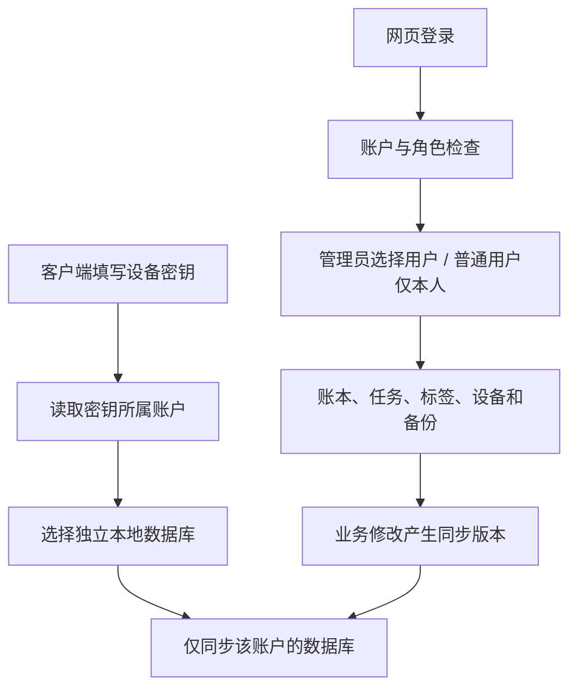

# 多用户同步与网页管理后台

适用版本：0.6.0，协议 4。网页与三端客户端共同使用同一套账户、设备和业务归属规则。

## 整体逻辑



服务端有一个账户目录数据库，保存用户、密码派生值、会话、设备归属及审计索引。每个用户另有独立 SQLite 数据库，保存该用户的账本、记录、标签、不可变版本、冲突及同步变更。因此，相同账本编号、标签编号或操作编号在不同账户下仍然独立。

普通用户提交其他用户编号、设备编号或业务编号，不会因此取得访问权限。管理员选择用户后也在该用户数据库内修改，不将其他账户内容混入同步批次。

## 首次使用

1. 部署者在服务器初始化唯一的 `admin` 账户，临时密码写入权限为 0600 的指定文件。
2. 浏览器访问 `https://time.example.com/lyushi/`，以 `admin` 登录并修改临时密码。
3. 在“用户管理”创建普通用户，保存本次显示的临时密码并私下交付。
4. 用户首次登录后修改密码，打开“设备”添加具名设备。
5. 保存本次生成的设备密钥，在对应客户端设置中填写服务器地址和密钥，点击“验证并连接账户”。

用户仅在网页输入用户名和密码；客户端同步继续使用设备密钥。网页密码与设备密钥是不同凭证，不能相互替代。网页不显示已保存的密码或设备密钥原文。

## 账户与设备规则

| 项目 | 行为 |
| --- | --- |
| 管理员 | 仅初始化一个，可管理全部普通账户与其数据，不能停用或删除自己 |
| 普通用户 | 只查看和管理本人账本、任务、标签、冲突及设备 |
| 用户名 | 3—32 位字母、数字、点、下划线或连字符，转为小写，创建后不修改 |
| 显示名称 | 支持中文，可修改，长度不超过 200 个 UTF-16 单元 |
| 临时密码 | 首次登录必须修改；管理员重置普通用户密码后同样要求修改 |
| 登录会话 | 七天有效；退出、改密、重置密码或停用账户后失效 |
| 设备数量 | 每账户最多十台有效设备，已撤销设备不占额度 |
| 密钥轮换 | 新密钥本次显示一次，旧密钥立即失效，设备名称和归属保留 |
| 停用账户 | 保留业务数据，使会话和全部设备权限失效 |
| 重新启用 | 不恢复旧会话或旧设备权限，须重新登录并创建设备 |
| 彻底删除 | 输入用户名确认，移除该用户业务文件、版本历史和设备归属 |

账户删除不承诺远程抹除离线设备上的文件，既有完整备份按部署者的保留规则处理。删除过程先撤销权限；文件清理失败时保留停用和删除状态，可重试清理，不恢复同步权限。

## 网页业务管理

“账本记录”按账本、事项文字及北京时间日期范围筛选，每页最多 50 条。可以新建账本、补记已结束任务、修改名称和标签、查看与修改分心区间、删除任务或整本账本。

进行中的任务仅显示状态，须在客户端结束后才能修改或删除。整本删除前输入账本名称确认，全部已知任务及分心区间共同生成删除版本；离线设备尚未上传的不同分支仍按同步规则保留。

“标签”管理候选列表。删除候选项不会改写历史任务中的名称快照；重新新增同名标签接续已知删除版本。

“冲突历史”只读显示并发或导入保留的版本，包含完整分心时间线。不会重新开始计时，也不提供强制覆盖入口。网页编辑以打开时的版本为前置条件，其他设备已经修改时要求刷新核对。

后台不承担日常计时，不提供开始、分心、恢复或结束按钮。页面浏览不改变客户端计时状态。业务表单只在明确保存时提交，不逐字同步；页面仅在前台且无编辑弹窗时定期刷新。

退出登录会清除网页已加载的账户列表、记录视图及弹窗；旧会话的延迟响应不会替换新用户页面。

## 客户端账户隔离

每次新连接先请求 `/v1/device` 读取用户和服务器身份，再选择本地数据库。首次从单机数据连接时，明确询问是否合并；切换到其他用户不自动搬运上一用户的数据。

数据库、待同步队列、游标、冲突与密钥均按本地账户分别保存。同一账户换密钥保留原数据，不同服务器身份使用新数据文件。已有账户可离线切换，当前账户正在记录时不能切换。

旧版单用户库不会自动变为新账户数据，旧同步身份也不能直接绑定新账户。保留旧记录时，应在旧客户端导出 JSON，再在目标账户导入。这样可以明确选择归属，并避免旧设备在服务器空白初始化后重新上传已清空内容。

## 用户数据导入导出

网页 JSON 导出只包含所选用户的账本、任务、标签、分心分段与冲突档案；不包含登录密码、会话或设备密钥。当前备份格式 3，继续导入格式 1、2。

导入先完整校验，再以一个事务提交。相同业务内容去重，已有编号下的不同内容另存档案，不覆盖当前版本或复活删除项。非法字段、时间、分段顺序或缺少所属账本时整次回滚。

网页导入上限为 8 MiB，客户端为 32 MiB。CSV 每个专注或分心区间各占一行，不另加重复计时的汇总行。用户存在活动任务时须先结束，再进行导入导出。

## 完整服务器备份与恢复

完整备份与用户 JSON 不同，包含 `catalog.sqlite`、`accounts/<用户编号>.sqlite` 及 `manifest.json`。目录快照与逐库 SQLite 一致性快照共同生成，包含账户权限和各用户历史。

```bash
sudo install -d -m 0700 -o lyushi -g lyushi /var/lib/lyushi/backups
sudo -u lyushi /opt/lyushi/lyushi-server --db /var/lib/lyushi/sync.sqlite \
  --backup /var/lib/lyushi/backups/server-backup.zip
```

目标文件必须不存在。应定期另存一份服务器外副本。恢复时先停止服务，并恢复至新的临时目录：

```bash
sudo systemctl stop lyushi
sudo python3 scripts/restore-server.py /path/to/server-backup.zip /var/lib/lyushi-restored
sudo chown -R lyushi:lyushi /var/lib/lyushi-restored
```

恢复脚本只接受固定文件白名单，核对用户清单、路径及 SQLite 完整性，不覆盖现有目录。确认恢复结果后，将原目录保留为回退副本，把恢复目录移至 `/var/lib/lyushi`，并将其中 `catalog.sqlite` 改名为 `sync.sqlite`，随后启动服务。目录切换前应核对实际路径，保留原目录及原备份。

恢复会更新各用户同步身份、清除会话、撤销设备并要求重新改密，防止旧备份重新启用已失效的凭证。管理员可使用本地重置命令取得新的临时密码；随后重新创建设备、连接客户端。客户端将为恢复后的服务器建立独立本地数据，需要保留的旧本地修改可通过 JSON 明确合并。

## 升级

协议 3 单用户服务的一次性空白初始化脚本为 `deploy/upgrade-multiuser.sh`。脚本会备份旧程序、数据库、服务单元及 Caddy 配置，清空旧业务和设备，创建空白管理员，再核验数据库与网页入口。它会拒绝对协议 4 目录再次执行清空。

需要保留单用户数据的部署应先导出 JSON，在新账户初始化后导入。常规多用户版本更新使用 `deploy/upgrade-server.sh`，不重新初始化或清空数据，保留全部用户及同步身份。

## 认证与运行边界

密码使用随机盐及 PBKDF2-SHA256，迭代 600000 次，不保存原文；设备密钥为 256 位随机数，目录只保存 SHA-256 摘要。网页会话使用 Secure、HttpOnly、SameSite=Strict Cookie，写操作执行同源和 CSRF 检查。登录验证限制并发和失败尝试，改密与账户状态变化后重新核对会话版本。

密码实现依据 [Go 标准库文档](https://pkg.go.dev/crypto/pbkdf2)；参数参考 [OWASP Password Storage Cheat Sheet](https://cheatsheetseries.owasp.org/cheatsheets/Password_Storage_Cheat_Sheet.html)。

网页操作日志保留 180 天，记录操作人、目标用户、动作及对象编号，不记录密码或设备密钥原文。同步历史位于各用户业务库，账户彻底删除时一并清理。所有管理和同步入口都在服务端校验权限，不依赖页面隐藏按钮。

服务仍使用单个 Go 进程，不新增常驻数据库、缓存或前端进程。网页静态资源不使用外部 CDN；原生客户端每秒读秒不访问服务器。现有 systemd 单元继续使用 96 MiB Go 内存软预算、192 MiB 服务上限及最多八个同步请求槽位。
