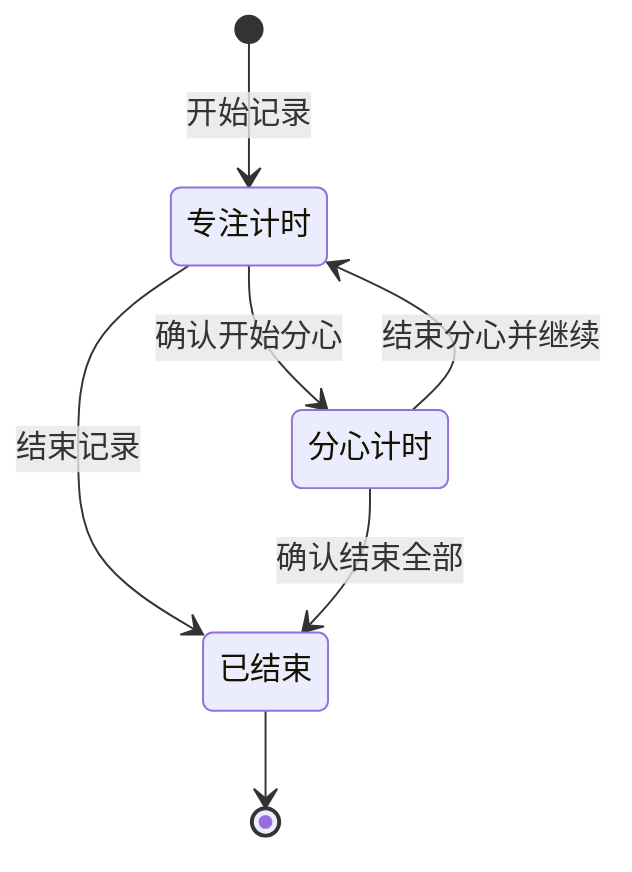

# 分心与任务恢复

适用版本：0.5.0。三端采用一致的操作、计时和数据规则。

## 操作流程

- 点击“分心一下”后填写临时事项，可选一个现有标签。事项留空记为“分心”，标签默认为无标签。
- 填写表单时原任务继续计时。只有确认后才切换，取消不产生记录。
- 分心期间显示当前分心时长及待恢复的原任务；不再开启下一层分心。
- 点击“结束分心并继续”立即恢复原事项和原标签；恢复后可以再次分心。
- 点击“结束全部”并确认后，结束整个任务，保留全部区间。
- 未结束的任务继续执行账本锁定规则，禁止切换账本、查看明细和导入导出。

## 时长与明细

| 时间区间 | 类型 | 事项 | 时长 |
| --- | --- | --- | --- |
| 10:00—10:20 | 专注 | 背单词 | 20 分钟 |
| 10:20—10:25 | 分心 | 点饭 | 5 分钟 |
| 10:25—10:40 | 专注 | 背单词 | 15 分钟 |

原任务有效时长为 35 分钟；完整经过时间为 40 分钟。分心时间不重复计入有效时长。没有运行中的分心时，主页面显示累计专注时长；分心时显示本次分心时长。

账本明细保留一条任务汇总，通过“查看分段”检查时间线。已结束任务的专注事项与标签统一修改，分心事项与标签分别修改。起止时间逐段修改，保留毫秒精度；允许间隙，拒绝重叠、逆序或未结束的历史区间。确认删除任务会同时删除全部区间，并同步删除状态。

CSV 每个区间一行，使用同一任务编号，并附区间序号与类型。按“专注”筛选后求和可得到有效时长；不额外导出会造成重复求和的任务汇总行。JSON 保留完整时间线及冲突档案，供完整备份恢复。

## 模块逻辑

| 模块 | 职责 |
| --- | --- |
| 三端主页面 | 展示当前阶段及读秒，提供开始分心、恢复与结束全部入口；确认表单时获取实际切换时间 |
| 任务与分段模块 | 保留原事项、标签和账本；在同一任务内关闭当前区间、打开下一区间，累计专注时间 |
| 本地存储模块 | 通过一个事务保存完整任务和待同步操作；失败时回滚，关闭应用后仍保留当前状态 |
| 同步模块 | 上传和接收完整任务版本；通过原有重试、分页保护和冲突档案保持时间线完整 |
| 服务端校验模块 | 拒绝非法分段、时间顺序、整体边界及超限数据；保存不可变版本，不合并并发时间线 |
| 明细与备份模块 | 任务汇总、分段编辑、整条删除、格式 3 JSON 备份及按区间导出 CSV |

每次切换只更新同一条任务，不产生第二条活动任务。原区间结束和新区间开始采用同一个毫秒时刻，一次切换只有一个同步操作。保存失败时仍保持切换前状态。

关闭应用、重启或断网后，应用按保存的最后区间恢复当前阶段，不依赖后台持续运行。另一设备同步后可接手分心或恢复任务。使用过期页面提交操作会被拒绝；离线设备各自产生的新版本分别保留为完整分支和只读冲突档案，不静默覆盖，也不相加统计。

## 兼容性与边界

- 客户端版本为 0.5.0，同步协议为 3，最低配套客户端为 0.5.0。旧客户端收到 HTTP 426，升级后可继续处理本地待同步记录。
- 原有无分段记录按单个专注区间读取，不重写历史操作，不重置数据库、设备密钥、服务器身份或游标。
- JSON 备份格式为 3，继续导入格式 1、2。旧客户端不应读取新备份。
- 每条任务最多保留 256 个区间，记录按服务端转义规则计量的紧凑 JSON 上限为 512 KiB。客户端追加区间时预留结束及版本字段空间；达到上限后应结束任务并新建记录。
- 时间仍固定显示为北京时间，取自设备系统时钟。时钟回拨造成逆序区间时拒绝提交，保留原记录并提示核对时间。

实现细节及数据字段见[同步协议](sync-protocol.md)。操作入口和构建方法见[中文项目说明](../README.md)及[英文项目说明](../README.en.md)。
